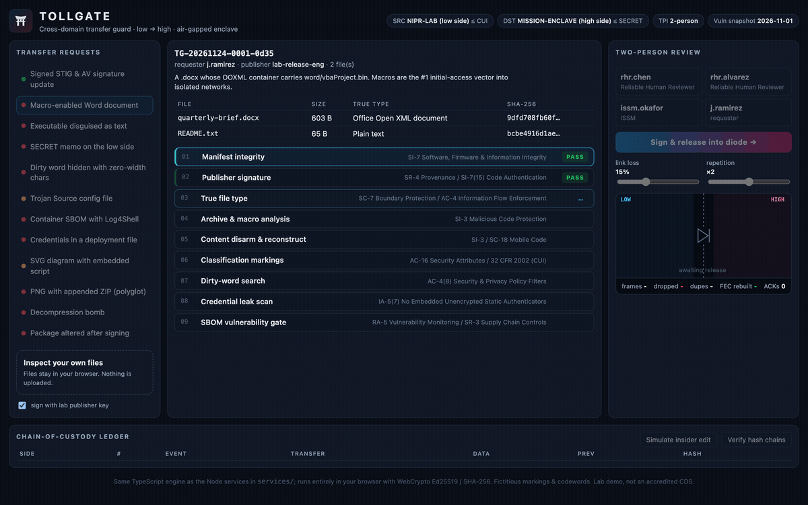
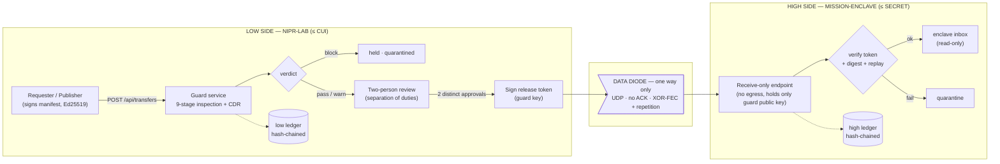

# TOLLGATE

**A cross-domain transfer guard for air-gapped enclaves.**

TOLLGATE controls the one thing every disconnected network still has to do: bring
data in from the outside without bringing in anything it shouldn't. It inspects a
low-side transfer through nine content-inspection stages, disarms what it can and
blocks what it can't, requires two-person human review, cryptographically signs a
release, and pushes the result across a **one-way data diode** — no return path,
no TCP, no acknowledgements — into the high-side enclave. Every action is written
to an append-only, hash-chained chain-of-custody ledger.

It is the Defense-Unicorns problem space — secure delivery into disconnected,
mission-owned environments — reduced to a single, runnable, auditable artifact.

> ⚠️ Lab demonstration of cross-domain *patterns* (NIST 800-53, Raise-the-Bar
> guard concepts). It is **not** an accredited cross-domain solution (CDS) and all
> classification markings and codewords in the samples are fictitious.



**Live demo:** https://tollgate-guard.vercel.app · the browser console runs the
*exact same TypeScript inspection engine* as the Node services, entirely client-side.

---

## Why this exists

Air-gapped and DDIL networks (classified enclaves, weapons platforms, ICS/SCADA)
can't pull patches, container images, threat-intel feeds or STIG content over the
internet. Those updates still have to get in. The import path is the highest-value
target an adversary has against an isolated network — it's how Stuxnet crossed the
gap. A cross-domain guard is the control that sits on that path. TOLLGATE
implements the guard pattern end to end so the trade-offs are concrete instead of
hand-waved on a slide.

## What it does

| # | Stage | What it catches | Control |
|---|-------|-----------------|---------|
| 1 | **Manifest integrity** | size/hash mismatch, smuggled unlisted files, path traversal, duplicate names | SI-7 |
| 2 | **Publisher signature** | unsigned or untrusted publisher, manifest altered after signing | SR-4, SI-7(15) |
| 3 | **True file type** | executables and type masquerade (an ELF named `notes.txt`) via magic bytes, never the extension | SC-7, AC-4 |
| 4 | **Archive & macro analysis** | VBA macros, OLE objects, zip-slip, encrypted entries, decompression bombs | SI-3 |
| 5 | **Content disarm & reconstruct (CDR)** | PDF JavaScript/OpenAction, PNG polyglots, SVG/HTML scripts, Trojan-Source bidi & zero-width chars | SI-3, SC-18 |
| 6 | **Classification markings** | spillage (SECRET content on a CUI network), portion marks exceeding the banner, destination over-accreditation | AC-16, 32 CFR 2002 |
| 7 | **Dirty-word search** | restricted codewords/patterns — run *after* CDR so evasion with hidden characters still hits | AC-4(8) |
| 8 | **Credential leak scan** | AWS keys, private keys, Vault/GitHub/Slack tokens, hard-coded passwords | IA-5(7) |
| 9 | **SBOM vulnerability gate** | CycloneDX components matched against an **offline** CVE/KEV snapshot (Log4Shell, Spring4Shell, xz backdoor…) and denied licenses | RA-5, SR-3 |

Nothing short-circuits: every stage runs so the reviewers and the ISSM see the
whole picture. The verdict is the worst finding — `PASS`, `WARN` (released with the
disarmed content and a reviewer note) or `BLOCK`.

## Architecture



The two sides share **nothing** but the diode and the guard's public key. The
high-side process binds a UDP socket, only ever reads from it, opens no outbound
connections and holds no private key. In Kubernetes an egress-`[]` NetworkPolicy
enforces the one-way property in software (`deploy/k8s/highside.yaml`); in
production a hardware diode enforces it physically.

### The diode link

A real diode has no back-channel, so TCP, TLS and "please resend" are all
impossible. TOLLGATE ships enough redundancy up front to rebuild the bundle blind:

- fixed-size framing with a per-bundle session id and total length,
- **XOR parity** per group of K data frames — recovers any one lost frame per group,
- **N× repetition** of the whole frame set, interleaved so a loss burst can't wipe both copies,
- a whole-bundle SHA-256 the receiver checks before it accepts anything.

The console's loss slider drives the real `Reassembler`; push it past what the FEC
can carry and the transfer lands `unrecoverable` — exactly as it would on a diode,
where the only fix is to raise repetition and send again.

### Two-person integrity & custody

Release needs two **distinct** authorized reviewers, and the requester can never
review their own transfer (separation of duties). Blocked transfers can't be
approved at all. The guard then signs a release token binding the transfer id, the
post-CDR bundle digest and the approver set; the high side rejects anything whose
digest, signature, approval count or id doesn't match, and refuses replays.

Both sides keep an append-only ledger where each entry commits to the previous
entry's hash. Editing, deleting or reordering any record breaks every hash after
it — the console's **"simulate insider edit"** button does exactly that and
**"verify hash chains"** pins the break to an entry number.

## Certification mapping

Built to double as hands-on evidence for the certs on my roadmap:

- **CompTIA CASP+ / SecurityX** — cross-domain boundary protection, information-flow enforcement (AC-4), supply-chain risk (SR), security architecture trade-offs.
- **CompTIA Security+** — data classification & handling, integrity/signing, least privilege, separation of duties.
- **CKS (Certified Kubernetes Security Specialist)** — Pod Security `restricted`, egress NetworkPolicy as a one-way control, read-only root FS, dropped capabilities, non-root, no service-account token.
- **CompTIA PenTest+ / CySA+** — the sample set *is* the attacker: macro droppers, polyglots, zip bombs, Trojan-Source, type masquerade, credential spills.

## Run it

```bash
npm install
npm test                       # 21 unit tests + a real-process, real-UDP e2e run
```

### End-to-end (real processes + a real UDP diode)

```bash
npm run tg -- keygen           # guard + lab publisher Ed25519 keys under keys/
TG_SIM_LOSS=0.15 npm run demo  # submit every scenario, review, release, verify both ledgers
```

### Containers (two sides, three networks, one-way by construction)

```bash
docker compose up --build      # highside network is internal: no route out of the enclave
```

### Operator CLI

```bash
npm run tg -- pack lab-release-eng ./release-notes.txt ./app.cdx.json > transfer.json
curl -XPOST localhost:8080/api/transfers -H 'x-tg-user: j.ramirez' -d @transfer.json
npm run tg -- verify-ledger low      # re-verify the persisted hash chain
```

### Browser console

```bash
npm run dev                    # same engine, client-side; ?auto runs the scripted walkthrough
```

## Design notes

- **One engine, two runtimes.** `core/` is environment-agnostic TypeScript using
  only WebCrypto (Ed25519, SHA-256) and standard streams, so the browser console
  and the Node services run byte-for-byte identical inspection logic.
- **No runtime dependencies.** Node ≥ 23.6 runs the TypeScript directly via type
  stripping; the image ships source with no build step — which is itself friendly
  to air-gapped image import.
- **Offline by design.** The vulnerability snapshot is dated and versioned, and is
  meant to be imported *through TOLLGATE itself* — it's just another signed package.

## Project layout

```
core/        inspection engine: magic bytes, zip, stages, CDR, diode FEC, ledger, release
services/    lowside guard API · highside receiver · operator CLI · e2e demo
src/         browser operator console (React) — same core engine
deploy/k8s/  namespaces, one-way NetworkPolicies, hardened Deployments
policy/      declarative guard policy (levels, trust store, dirty words, limits, reviewers)
test/        unit + end-to-end suites
```
